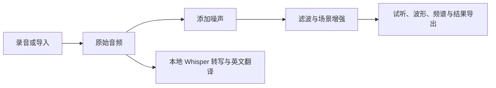
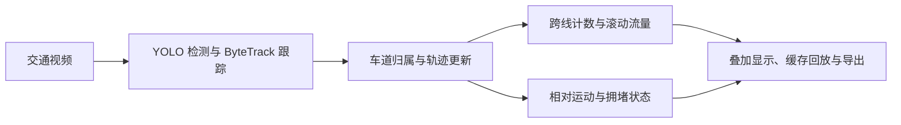
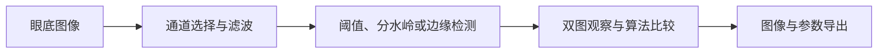

# 信号处理实习 · 三个项目介绍

作者：cin330  
最终版本：v1.0.0  
整理日期：2026-10-13  
授权：AGPL-3.0，原创部分保留作者署名，第三方内容遵守各自许可证。

这三个项目分别围绕声音、视频与医学图像建立交互式处理流程。它们都采用 Python 和 PySide6 构建桌面界面，把算法处理、参数调整、结果观察和文件导出放在同一个应用中。当前发布以本地现有代码为基础，未恢复已经清理的演示制作目录。

| 项目 | 输入 | 核心处理 | 输出 | GitHub |
|---|---|---|---|---|
| 语音采集及其降噪系统 | 麦克风、音频文件 | 噪声模拟、三种去噪、场景增强、识别翻译 | 音频、波形、频谱、对比结果 | [audio-lab](https://github.com/cin330/audio-lab) |
| 交通视频监控系统 | 本地交通视频 | YOLO 检测、ByteTrack 跟踪、分车道计数、拥堵分析 | 可视化结果、统计 CSV、事件和元数据 | [traffic-video-monitor](https://github.com/cin330/traffic-video-monitor) |
| 视网膜血管图像分割系统 | 眼底图像 | 预处理、Otsu、分水岭、六种边缘算法 | 处理图像、算法比较图、参数 JSON | [retinal-vessel-system](https://github.com/cin330/retinal-vessel-system) |

## 一、语音采集及其降噪系统

### 项目目标

以可交互的音频实验平台展示语音从采集、加噪到恢复的过程，帮助比较不同去噪方法的处理结果，并提供场景增强与语音识别扩展。

### 主要功能

- 录制、导入、播放与保存音频，观察时域波形和频域特征。
- 添加高斯噪声与脉冲噪声，建立具有已知参考信号的对比实验。
- 比较维纳滤波、卡尔曼滤波和小波去噪，结合信噪比与听感观察处理差异。
- 支持突出人声、突出音乐、突出环境和原始平衡模式，按强度在原音频与处理结果间插值。
- 使用本地 Faster Whisper 模型完成多语言转写和英文翻译，支持文件与麦克风工作流。
- 使用后台线程执行处理，管理任务状态、停止操作、语音分段和结果输出。

### 结构与处理流程

`audio/` 管理采集和播放，`noise/` 生成噪声，`denoise/` 实现滤波，`analysis/` 提供波形、频谱和指标，`enhancement/` 提供场景增强，`ai/` 管理识别与翻译，`gui/` 组织交互界面。

### 当前验证与边界

19 项现有测试通过，覆盖界面控制、增强强度、识别线程、语音分段和停止流程。识别测试使用模拟模型；本次未重新实测真实麦克风与 GPU 转写。当前 AI 实现要求兼容 NVIDIA CUDA 环境，没有 CPU 自动回退。Whisper 权重通过项目提供的脚本下载，不纳入 Git 历史。

## 二、交通视频监控系统

### 项目目标

把固定摄像机的道路视频转换为可观察的车辆轨迹、分车道流量和交通状态，形成从视频打开、机位配置到结果导出的完整操作流程。

### 主要功能

- 打开、播放、暂停、跳转和倍速回放本地视频。
- 加载 YOLO 权重并执行 ByteTrack 跟踪，筛选 car、truck、bus、van 四类车辆。
- 在视频画面上绘制车道、计数线及监测区域，配置通行方向与分析参数。
- 根据车辆轨迹统计有方向的跨线事件，按车辆 ID 去重并统计近 60 秒流量。
- 结合车辆聚集程度和相对低速比例计算拥堵指数，通过持续时间与状态迟滞控制状态切换。
- 在后台顺序执行检测和完整视频分析，缓存分析元数据，支持分析后的定位回放。
- 导出统计 CSV、事件 CSV 和元数据 JSON，记录车道配置与分析参数。

### 结构与处理流程

`detect/` 提供模型调用、车道管理和检测分析组件，`core/` 提供后台任务、逐帧分析和回放，`gui/` 提供界面与车道编辑，`config/lanes/` 提供机位示例，`models/best.pt` 和 `video/car_stream.mp4` 保留必要的本地示例。

### 当前验证与边界

18 项现有测试通过，覆盖 GUI 流程、配置校验、跨线计数、车道归属、拥堵迟滞、缓存回放和导出。GUI 测试使用模拟检测结果，不证明 YOLO 在真实道路上的检测精度。当前处理本地视频，不宣称已经支持网络摄像机。相对运动指标没有经过真实物理速度标定；车道和拥堵阈值需要按机位调整。

保留实际运行所用 Ultralytics 8.4.175 源码及其 AGPL-3.0 许可证，未上传上游 Git 历史、训练数据集和重复训练产物。

## 三、视网膜血管图像分割系统

### 项目目标

为眼底图像处理提供统一的观察和实验界面，帮助理解预处理、阈值分割与边缘检测的差异，并保存可复查的算法结果与参数。

### 主要功能

- 导入眼底图像，显示图像信息与预处理预览。
- 调节灰度、绿色通道输入、窗宽窗位、高斯滤波和自适应中值滤波。
- 支持左右图像同步缩放、平移、旋转、ROI 操作与视图重置。
- 执行 Otsu 自动阈值与自适应分水岭分割，调整各自参数。
- 比较 Sobel、Prewitt、Roberts、Canny、Laplacian、Scharr 六种边缘检测方法。
- 在后台执行处理，支持多算法比较及参数调整后的预览更新。
- 导出原图、当前结果、八种算法结果、比较图及参数 JSON；区分算法原始像素与显示变换。

### 结构与处理流程

`retinal_vessel_system/processing/` 实现图像处理，`core/` 管理状态与后台任务，`gui/` 组织参数面板和同步视图，`utils/` 实现读写、比较图和导出。`data/retina.jpg` 为原项目示例，`docs/` 保留原有界面预览及历史验证记录。

### 当前验证与边界

39 项现有测试通过，覆盖处理算法、GUI 操作、图像读写和导出。原项目保留了真实示例图像上的算法和交互验证记录，但本次未重新运行整套历史验证脚本。尚未提供基于真实血管标注数据集的 Dice、IoU 等精度评估；当前定位是教学与算法比较系统。

## 四、最终版本与版权

三个项目均以 `v1.0.0` 冻结；本次验证合计 76 项现有测试通过。各仓库的 `FINAL_VERSION.json` 记录文件 SHA-256、验证信息和冻结时间。原始业务逻辑保持一致，仅增加版权注释、安装说明与发布文档。

Copyright (c) 2026 cin330，限作者原创部分。项目以 AGPL-3.0 发布：允许按许可证使用、修改和分发；必须保留版权与许可证声明，并履行相应源码提供义务。第三方组件、模型及示例文件的权利仍归各自权利人，详见各仓库 `THIRD_PARTY.md`。完整许可证见 `LICENSE`。
